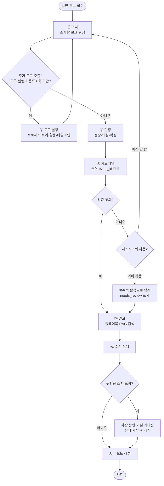
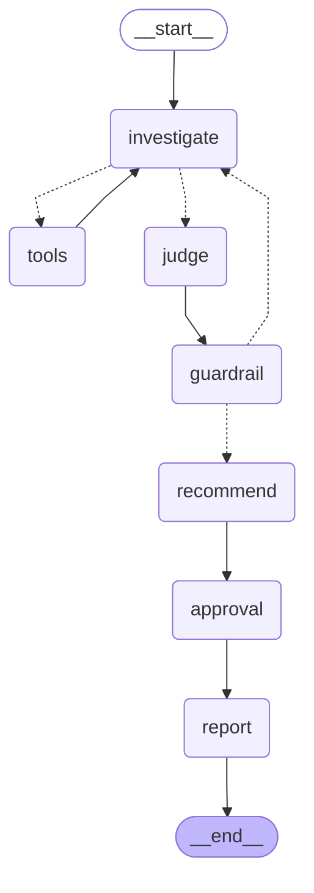

# 아키텍처

> D1-13 **화이트보드 설계** + D1-14 **LangGraph 뼈대 구현 기록** (2026-11-18). 아래 1장의 첫 그림은 D1-13 설계안이며, 뒤의 D1-14 절에는 실제 출력한 Mermaid를 따로 보존합니다. **그래프 출력과 `pytest tests/test_graph_skeleton.py -q`의 2 passed를 직접 확인했습니다.**
> 기준: `docs/guide/DAY1.md` 4-1, `docs/prep/01_edr_soc_intro.md` 5장, `src/soc/agent/state.py`, `docs/CONTRACT.md`.

## 1. 에이전트 설계도 (D1-13)

아래 Mermaid는 **D1-13에서 직접 작성한 설계용 그림**입니다. **D1-14에서 노드·Edge를 실제 연결한 뒤** `python -m soc.agent.graph`가 Mermaid 출력을 생성한 것을 확인했습니다. 실행된 코드가 만든 원본 그래프는 **4. D1-14 실제 실행 결과**에 별도로 붙였습니다. 사람 승인 대기는 여전히 Day2 구현 범위입니다.



### 1-1. 노드별 역할 / 읽는 상태 / 쓰는 상태

| 노드 | 하는 일 | 읽는 상태 | 쓰는 상태 | 쓰는 도구 | 담당 |
|---|---|---|---|---|---|
| 조사 (`investigate`) | 알림·이전 대화를 보고 필요한 로그 결정 | `alert`, `messages`, `tool_rounds` | `messages`, `trace`, `usage` | 도구 호출 계획 | 📘 (D1-14) |
| 도구 실행 (`tools`) | 프로세스·파일·시간대별 로그 조회 | `messages` | `messages`, `seen_event_ids`, `tool_rounds`, `trace` | 🔍 조사 도구 3개 | 👥 |
| 판정 (`judge`) | 정상·의심·악성, 신뢰도 판단 | `messages`, `seen_event_ids` | `verdict`, `trace`, `usage` | LLM | 👥 |
| 가드레일 (`guardrail`) | 인용 근거가 실제 조회 기록인지 확인 | `verdict`, `seen_event_ids`, `alert` | `guardrail`, `guardrail_log`, 실패 시 `guardrail_retries`·`verdict` | 근거 검증 | 📘 (Day2) |
| 권고 (`recommend`) | 플레이북 검색 후 대응 조치 권고 | `verdict`, `alert` | `playbook`, `recommendation`, `trace`, `usage` | 📘 `search_playbook` | 🔍 (D1-14) |
| 승인 (`approval`) | 위험 조치일 때 사람 승인 대기 | `recommendation` | `approval`, `trace` | 사람 승인(HITL) | 🔍 (Day2) |
| 리포트 (`report`) | 판정·로그 근거·정책·승인 결과 통합 | `alert`, `verdict`, `playbook`, `recommendation`, `approval`, `trace`, `usage` | `report`, `trace` | 결과 정리 | 👥 |

### 1-2. State: 공용 상태 정보

| 묶음 | State 필드 | 저장 내용 |
|---|---|---|
| 접수·조사 | `alert`, `messages`, `seen_event_ids`, `tool_rounds` | 알림, 대화, 실제 조회한 기록 ID, 도구 실행 라운드 수 |
| 판정·안전 | `verdict`, `guardrail`, `guardrail_log`, `guardrail_retries` | 판정, 근거 검증, 실패 이력과 재조사 수 |
| 대응·승인 | `playbook`, `recommendation`, `approval` | 매뉴얼 검색 결과, 권고, 사람 결정 |
| 산출·추적 | `report`, `trace`, `usage` | 보고서, 지나온 경로, 토큰 사용량 |

## 2. 갈림길 (Edge)

| 결정 | D1-13 설계안 | 코드 근거 |
|---|---|---|
| 조사 상한 | **도구 실행 라운드 최대 6회**. 추가 조사가 필요하면 `조사 → 도구 실행 → 조사` 반복 | `max_tool_rounds=6`. 라운드 한 번에 도구가 여럿 호출될 수도 있음 |
| 가드레일 실패 | **1회 재조사**. 재실패 시 확인 안 된 event_id는 제외하고 악성을 의심으로 낮추며 `needs_review` 표시 | `guardrail_on_fail="retry"`, `max_guardrail_retries=1` |
| 사람 승인 | 위험 조치만 대기: `block_ip`·`kill_process`·`isolate_host`·`reset_password`. 나머지는 승인 대기 없이 보고서로 | `DANGEROUS_ACTIONS` |

**아직 미구현:** `nodes.py`의 승인 함수는 현재 `not_implemented` 응답입니다. 위 사람 승인 경로는 목표 설계이며, 실제 승인/재개 성공을 의미하지 않습니다.

## 3. 배포 구성도 (2일차부터)

<!-- 01b 문서 2장의 그림을 실제 리소스(Deployment, StatefulSet, Job, Service, Ingress, Secret, ConfigMap)로 바꿔 그리기 -->

## 4. D1-14 그래프 뼈대 구현·실행 확인 (2026-11-18)

### 4-1. 구현한 파일과 D1-13 표의 연결

| D1-13 설계 요소 | D1-14 실제 구현 | 확인 상태 |
|---|---|---|
| **State** | `src/soc/agent/state.py`의 `TriageState` 재사용; `messages`, `seen_event_ids`, `tool_rounds`, `verdict`, `playbook`, `approval`, `trace` 등 | 기존 스키마와 연결 |
| **조사 노드 AG-1 (📘 운전 영역)** | `nodes.py`의 `investigate()`: 가짜 LLM에 조사 도구를 연결하고 경보·메시지 전달 | 코드 구현 |
| **권고 노드 AG-2 (🔍 운전 영역)** | `nodes.py`의 `recommend()`: `search_playbook(query, k=3)` 검색 → 구조화 권고 | 코드 구현 |
| **Edge AG-3 (👥)** | `graph.py`: 시작부터 종료까지 7개 노드 연결, 조사와 가드레일의 조건부 Edge | **Mermaid 출력으로 연결 확인** |
| **가드레일 및 사람 승인** | 그래프 노드는 연결됨. 실제 근거 검증 G-1·G-2와 승인 중단/재개 H-1·H-2는 Day2 과제 | 연결만 완료, 기능은 별도 |

### 4-2. 실제 실행한 명령과 Mermaid 결과

사용자가 자신의 Windows 프로젝트 환경에서 아래 명령을 실행했고, `NotImplementedError` 없이 실제 그래프 구조가 출력됐습니다.

```powershell
python -m soc.agent.graph
```

**아래는 실행 출력 그대로 기록한 Mermaid입니다.** `investigate`와 `guardrail`의 점선이 조건부 분기, `tools → investigate`가 반복 경로입니다.



### 4-3. 코드 기반 그래프와 설계안 비교

| 검토 항목 | 실제 출력 |
|---|---|
| 노드 | `investigate`, `tools`, `judge`, `guardrail`, `recommend`, `approval`, `report` **7개 확인** |
| 조사 분기 | `investigate → tools` 또는 `judge`; `tools → investigate` 반복 |
| 가드레일 분기 | `guardrail → investigate` 또는 `recommend` |
| 최종 경로 | `recommend → approval → report → __end__` |
| 파라미터 | 조사 라운드 최대 **6**, 가드레일 실패 시 재조사 최대 **1** (설정 파일) |
| 사람 승인 | **위험한 조치만 사람 승인**이 설계 목표이나, 현재 승인 노드는 실제 일시정지 없이 `not_implemented`를 반환 |

### 4-4. 테스트와 체크표 처리

- **확인 완료:** `python -m soc.agent.graph` 실행으로 **실제 Mermaid 그래프 생성 성공**.
- **테스트 통과 확인:** `pytest tests/test_graph_skeleton.py -q` 실행 결과 **2 passed in 3.92s**를 직접 확인했습니다.
- **D1-14 완료:** AG-1~3 구현, 그래프 뼈대 테스트 통과, Mermaid 실제 출력까지 확인했습니다.

```powershell
python -m pytest tests/test_graph_skeleton.py -q
```

> D1-13 설계용 그래프와 D1-14 실행 결과는 구분해 기록합니다. D1-15 티치백은 `docs/teachback/day1.md`에 완료 기록했으며, Day2 실제 근거 검증 및 사람 승인은 별도 범위입니다.
